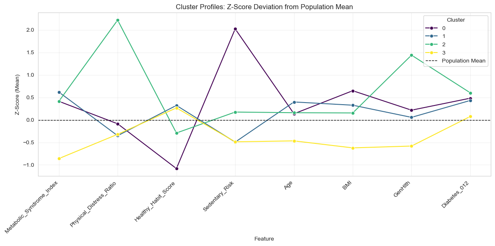
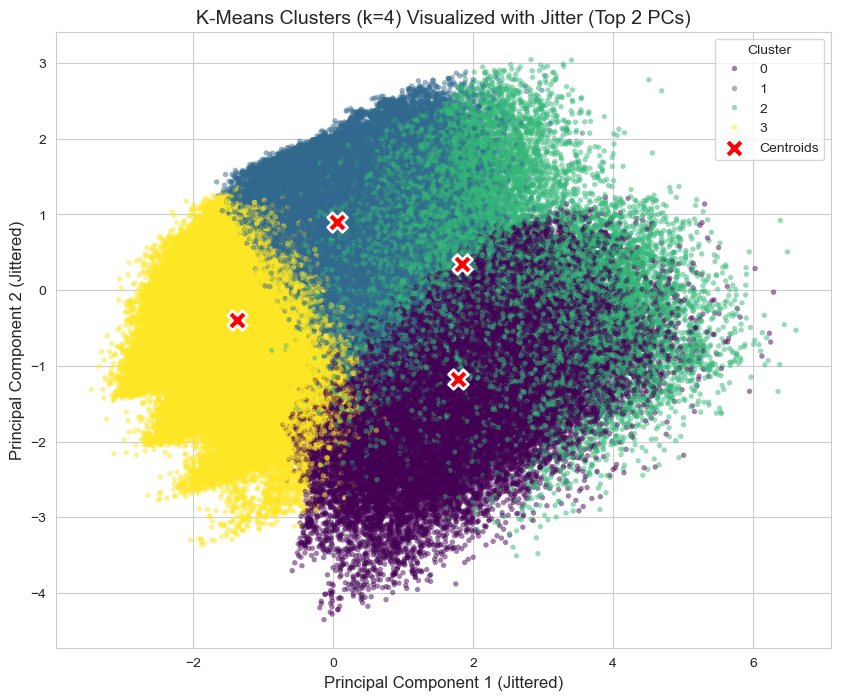
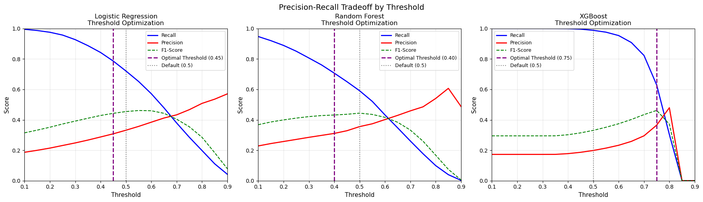
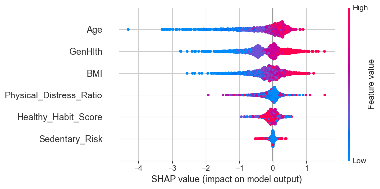

# Diabetes Risk Analysis: Segmentation & Prediction on CDC BRFSS Data

**Roshan Balaji Mahashabde** · FAIDM Individual Project, University of Warwick



## Problem

Diabetes risk builds up across clinical, lifestyle and demographic factors. A public-health team needs two things from survey data:

1. **Segmentation**: which distinct groups exist in the population, and what kind of intervention suits each one?
2. **Screening**: can we flag people who have prediabetes or diabetes from a few survey answers, while missing as few cases as possible?

The classes are heavily imbalanced, so the project optimises for **recall on the at-risk class** rather than accuracy.

## Data

| | |
|---|---|
| **Source** | [CDC Diabetes Health Indicators (BRFSS 2015), Kaggle](https://www.kaggle.com/datasets/alexteboul/diabetes-health-indicators-dataset): `diabetes_012_health_indicators_BRFSS2015.csv` |
| **Size** | 253,680 survey responses × 22 columns (21 features + target) |
| **Target** | `Diabetes_012`: 0 = no diabetes, 1 = prediabetes, 2 = diabetes |
| **Cleaning** | No missing values. 23,899 exact duplicates (9.42%) removed, leaving **229,781 rows** |
| **Class balance (after dedup)** | 82.7% healthy · 2.0% prediabetes · 15.3% diabetes |

The strongest raw correlates of `Diabetes_012` are `GenHlth` (r = 0.30), `HighBP` (0.27), `BMI` (0.22), `DiffWalk` (0.22) and `HighChol` (0.21).

The data is not included in this repo. See [How to run](#how-to-run).

## Method

**1. EDA & feature engineering** ([01_eda_and_prep.ipynb](diabetes-risk-analysis/notebooks/01_eda_and_prep.ipynb))
- Composite features:
  - **Metabolic Syndrome Index** = `HighBP + HighChol + (BMI > 30)`
  - **Physical Distress Ratio** = `(PhysHlth + MentHlth) / 30`
  - **Healthy Habit Score** = `PhysActivity + Fruits + Veggies`
  - **Sedentary Risk** = no physical activity *and* BMI > 25
- Log transform of BMI/PhysHlth, standard scaling, VIF and Random Forest importance checks, PCA, and a one-hot transaction matrix prepared for association-rule mining.
- Modelling uses 7 features: the four composites plus `Age`, `BMI` and `GenHlth`.

**2. Clustering** ([02_clustering_analysis.ipynb](diabetes-risk-analysis/notebooks/02_clustering_analysis.ipynb))
- **K-Means** on PCA components retaining 95% of the variance, with a grid search over k = 2–10 and two init methods (elbow + silhouette). k = 4 was chosen for interpretability.
- **K-Prototypes** for mixed categorical/continuous data (k = 4, Cao init).
- **Hierarchical** (5k sample): grid over linkage × distance metric, scored by cophenetic correlation.
- Segments are profiled against diabetes status and explained with a surrogate Random Forest + SHAP.

**3. Binary classification**: healthy vs prediabetes/diabetes ([03_classification_model.ipynb](diabetes-risk-analysis/notebooks/03_classification_model.ipynb))
- Logistic Regression, Random Forest and XGBoost, trained on SMOTE-balanced data with a stratified 80/20 split.
- RFECV feature check, Optuna TPE tuning (30 trials, scored on recall), decision-threshold search (maximise recall subject to precision ≥ 30%), isotonic calibration, and a weighted hard-voting ensemble.
- `Metabolic_Syndrome_Index` and every cluster label are dropped to avoid leakage. 6 features remain.

**4. Multi-class classification**: healthy / prediabetes / diabetes ([04_classification_multi.ipynb](diabetes-risk-analysis/notebooks/04_classification_multi.ipynb))
- The same three models, trained with SMOTE and tuned with Optuna on weighted F1.
- Aggressive class weights `{0: 1, 1: 50, 2: 5}`, a Balanced Random Forest tuned on macro F1, a class-2 threshold override, and SHAP on XGBoost.

## Results

### Segmentation: four patient personas (K-Means, k = 4)



| Cluster | Persona | Share | Pre/diabetic | Defining traits (z-scores) |
|---|---|---|---|---|
| 3 | **Resilient & Active** | 38.0% | 4.3% | Lowest metabolic index (−0.86), youngest (−0.47), best general health (−0.58) |
| 1 | **Metabolic Vulnerable** | 34.1% | 23.0% | Highest metabolic index (+0.62) and oldest (+0.40), despite being active with good habits |
| 0 | **Sedentary Behavioural** | 16.4% | 25.5% | Extreme sedentary risk (+2.03), worst habit score (−1.08), highest BMI (+0.65) |
| 2 | **Acute Distress** | 11.5% | 31.7% | Very high physical distress (+2.22), worst general health (+1.44) |

The segments split cleanly by outcome: the at-risk rate ranges from 4.3% to 31.7%. Each points to a different intervention: maintenance, medication management, lifestyle coaching, or integrated care.

On internal metrics the clusters show fair rather than strong structure:
- K-Means k = 4 silhouette: 0.203 (10k sample).
- Hierarchical (average linkage, Manhattan distance; cophenetic correlation 0.693): silhouette 0.253. Hierarchical scored best on both silhouette and Davies-Bouldin, but it was fitted on a 5k sample, so K-Means labels are used for the personas.

### Binary screening (test set n = 45,957; 7,945 at-risk)



| Model | Threshold | Recall (at-risk) | Precision (at-risk) | F1 (at-risk) | Accuracy |
|---|---|---|---|---|---|
| Baseline Logistic Regression | 0.50 | 72% | 33% | 0.45 | 70% |
| Baseline Random Forest | 0.50 | 43% | 32% | 0.37 | 75% |
| Baseline XGBoost | 0.50 | 85% | 27% | 0.41 | 58% |
| Tuned Logistic Regression | 0.45 | **78.6%** | 30.8% | – | – |
| Tuned Random Forest | 0.40 | 70.7% | 31.1% | – | – |
| **Tuned XGBoost (selected)** | 0.75 | 62.9% | **36.5%** | **0.462** | **74.7%** |
| Weighted voting ensemble (hybrid thresholds) | – | 83% | 29% | 0.43 | 62% |

- The automated selection rule (≥ 60% recall on *both* classes, then highest F1) picks **tuned XGBoost at threshold 0.75**: 62.9% sensitivity, 77.2% specificity.
- If catching cases matters most, **tuned Logistic Regression at threshold 0.45** finds 78.6% of at-risk people, at 30.8% precision.

### Multi-class (healthy / prediabetes / diabetes)

| Model | Accuracy | Macro F1 | Recall: Healthy | Recall: Prediabetes | Recall: Diabetes |
|---|---|---|---|---|---|
| Tuned XGBoost (SMOTE) | 74% | 0.41 | 82% | 4% | 41% |
| Tuned Logistic Regression (SMOTE) | 62% | 0.41 | 64% | 23% | 59% |
| Balanced RF (tuned) | 60% | 0.40 | 60% | 22% | 65% |
| Weighted Logistic Regression | 51% | 0.37 | 55% | **59%** | 30% |
| **Weighted XGBoost (selected)** | 52.8% | 0.377 | 54.8% | 46.4% | 42.3% |

The selection rule (≥ 30% recall on every class, then highest macro F1) picks **weighted XGBoost**. It is the only model that recalls more than 40% of each class.

Prediabetes remains the bottleneck. Its **precision is about 3% for every model**: with these features, prediabetic respondents can barely be told apart from healthy or diabetic ones.



SHAP ranks **Age, GenHlth and BMI** as the main drivers of a diabetes prediction, ahead of the engineered distress, habit and sedentary features.

### Limitations

- Classification uses only 6 compact features. Raw indicators such as `HighBP`, `HighChol` and `DiffWalk` are excluded, which caps performance.
- In the Optuna searches SMOTE runs *before* cross-validation, so CV scores are optimistic. For example, XGBoost's CV recall is 0.996, against 0.63 on the test set at the chosen threshold. The held-out test-set numbers above are the ones to trust.
- PCA kept 7 of 7 components to reach 95% variance, so it decorrelates the features rather than reducing them.
- BRFSS is self-reported, cross-sectional survey data. These are associations, not causes.

## How to run

**Requirements:** Python 3.12. Tested with scikit-learn 1.8, numpy 2.3, xgboost 3.1, imbalanced-learn 0.14, optuna 4.7, kmodes 0.12, shap 0.48.

```bash
git clone <this-repo-url>
cd FAIDM-Individual
python -m venv .venv
# Windows: .venv\Scripts\activate    macOS/Linux: source .venv/bin/activate
pip install -r requirements.txt
```

**Data:** download `diabetes_012_health_indicators_BRFSS2015.csv` from the [Kaggle dataset page](https://www.kaggle.com/datasets/alexteboul/diabetes-health-indicators-dataset) and save it as:

```
diabetes-risk-analysis/data/raw/CDC Diabetes Dataset.csv
```

**Run the notebooks** from `diabetes-risk-analysis/notebooks/` (`jupyter lab`), in this order:

1. `01_eda_and_prep.ipynb`, **sections 1–13**: writes the scaled, PCA and transaction datasets to `data/processed/`.
2. `02_clustering_analysis.ipynb`: writes `diabetes_with_clusters.pkl`.
3. `01_eda_and_prep.ipynb`, **section 14** (last three cells): reads the clustered data and writes `diabetes_final_processed.pkl`.
4. `03_classification_model.ipynb`: binary models.
5. `04_classification_multi.ipynb`: multi-class models.

Optuna tuning is the slow part: roughly 15 minutes for notebook 03 and 30 minutes for notebook 04 on a laptop CPU. Saved outputs are already in the notebooks, so you can read every result without re-running anything.

## Project structure

```
FAIDM-Individual/
├── README.md
├── requirements.txt
├── docs/images/                 # Figures used in this README
└── diabetes-risk-analysis/
    ├── data/
    │   ├── raw/                 # Put the Kaggle CSV here (not tracked)
    │   └── processed/           # Generated by the notebooks (not tracked)
    └── notebooks/
        ├── 01_eda_and_prep.ipynb
        ├── 02_clustering_analysis.ipynb
        ├── 03_classification_model.ipynb
        └── 04_classification_multi.ipynb
```

## License

Academic coursework, shared for educational purposes.
